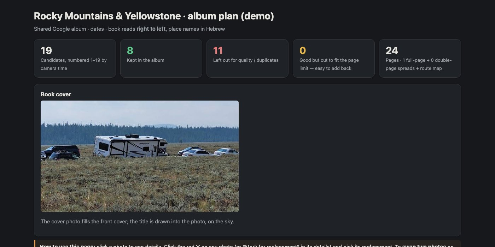
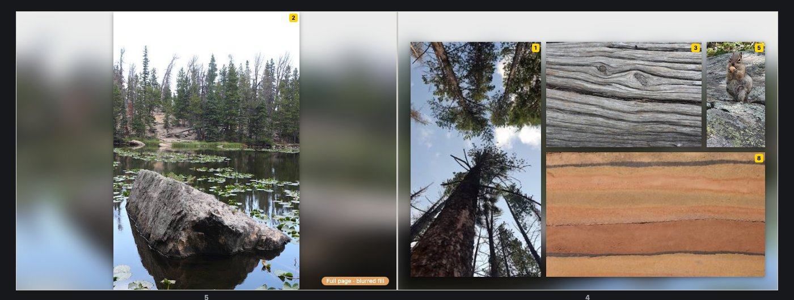
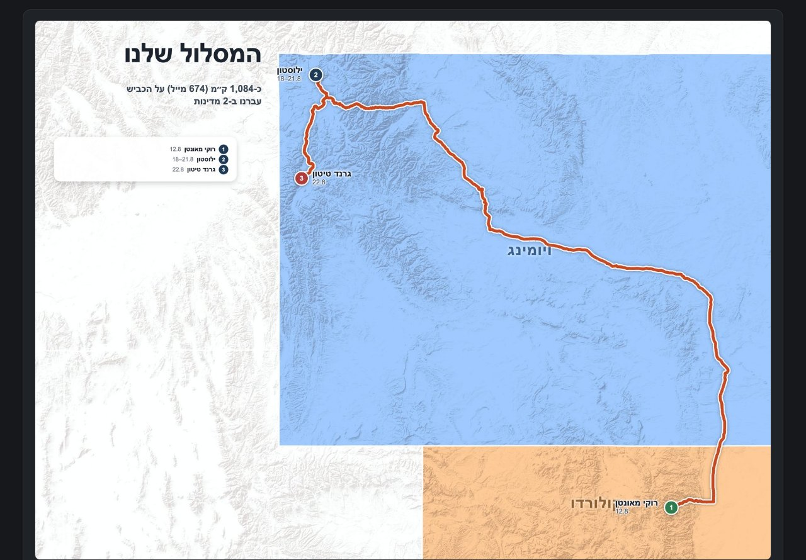

# Digital album: from a Google Photos link to a printed photo book

A Claude-powered tool that turns a shared Google Photos album of a trip into a printed photo book, step by step:

1. **Learns the trip** from the album link: number of photos, dates, places.
2. **Learns the album maker**: books, sizes, page limits, current sales, coupons and vouchers, shipping.
3. **Suggests the best book and theme** for your photos.
4. **Builds a plan** of the whole book. It picks the best photos, fixes light and colour, straightens
   horizons and draws a route map. You see every page.
5. **Lets you change anything**: mark photos on the plan, or just ask ("swap 165 and 172",
   "make 498 a full page").
6. **Builds the book in the album editor.** Fully automatic for Lupa; for other makers it makes
   print-ready files and guides you through the upload.
7. **Adds QR codes** for your videos, in the right place, so they scan and never cover a face.
8. **Runs a final print check** before you order: sharpness, cropping, spelling, QR codes and the best price.

It never orders, never enters passwords and never edits a photo with generative AI.

*Demo plan made from 19 sample photos (people left out on purpose).*

## Coming soon
The next version is in private development. The code is no longer published here.

Interested, or want early access? Contact **idanshenhav@gmail.com**.

## License
Copies of version 2.0 that were downloaded earlier remain under the
[PolyForm Noncommercial License 1.0.0](LICENSE): personal use only. Any commercial use needs written
permission ([commercial-use explanation](COMMERCIAL-LICENSE.md)).

---

# אלבום דיגיטלי: מקישור של Google Photos לספר מודפס

כלי מבוסס Claude שהופך אלבום משותף של טיול ב-Google Photos לספר תמונות מודפס: לומד את הטיול ואת חברת
האלבומים, ממליץ על ספר ועיצוב, בונה תוכנית עם התמונות הטובות ביותר, בונה את הספר בעורך, מוסיף קודי QR
לסרטונים ובודק הכול לפני ההזמנה.

**בקרוב.** הגרסה הבאה בפיתוח פרטי, והקוד כבר לא מפורסם כאן. רוצים גישה מוקדמת? **idanshenhav@gmail.com**
