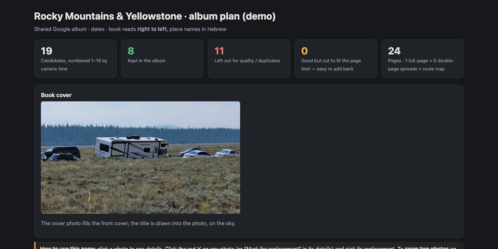
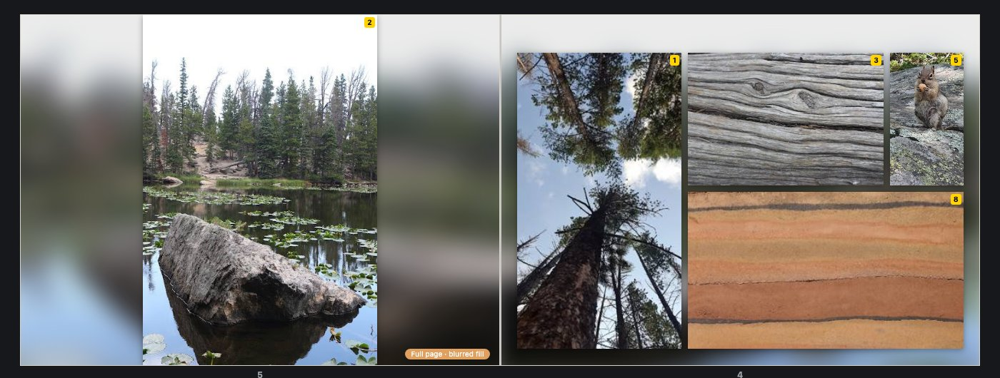
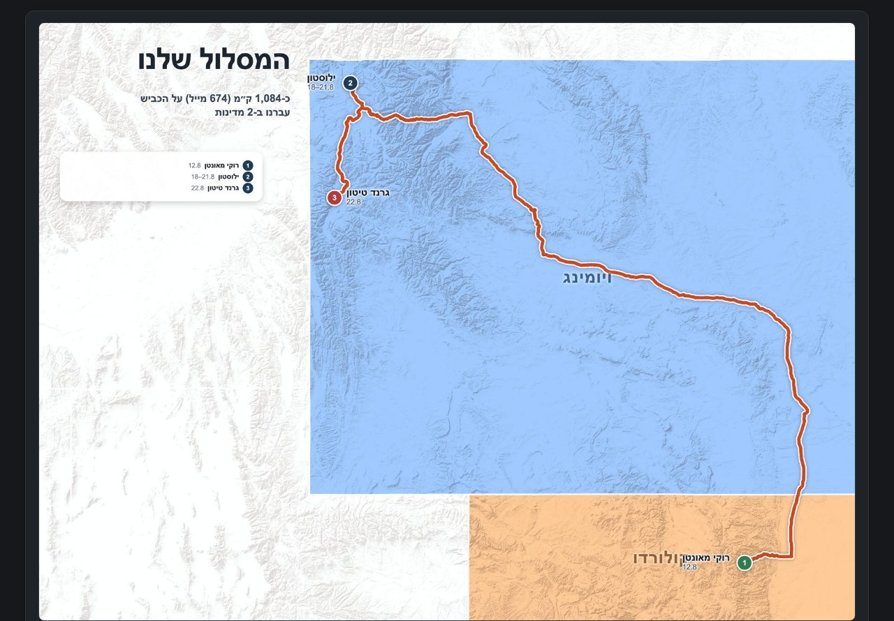

# Digital album: from a Google Photos link to a printed photo book

**Version 2.0 — built for Claude, free for personal use. Commercial use needs permission.**

A Claude skill that turns a shared Google Photos album of a trip into a printed photo book, step by step:

1. **Learns the trip** from the album link: number of photos, dates, places.
2. **Learns the album maker**: books, sizes, page limits, current sales, coupons and vouchers, shipping.
3. **Suggests the best book and theme** for your photos.
4. **Builds an HTML plan** of the whole book. It picks the best photos, fixes light and colour, straightens
   horizons and draws a route map. You see every page.
5. **Lets you change anything**: mark photos on the plan, or just ask in chat ("swap 165 and 172",
   "make 498 a full page").
6. **Builds the book in the album editor** in your browser. Fully automatic for Lupa; for other makers it
   makes print-ready files and guides you through the upload.
7. **Adds QR codes** for your videos, in the right place, so they scan and never cover a face.
8. **Runs a final print check** before you order: sharpness, cropping, spelling, QR codes and the best price.

It never orders, never enters passwords and never edits a photo with generative AI.

### ⬇️ [Download digital-album.zip](https://github.com/Idanshenhav/digital-album/releases/latest/download/digital-album.zip)

*Demo plan made by the skill from 19 sample photos (people left out on purpose).*

## Install

**Claude desktop / Cowork:** [download digital-album.zip](https://github.com/Idanshenhav/digital-album/releases/latest/download/digital-album.zip), then go to Settings → Capabilities → Skills → upload the zip.

**Claude Code:** copy the `digital-album` folder into `~/.claude/skills/`.

Then say: *"Make a photo album from this Google Photos link: …"*

You need the Claude in Chrome extension (for the album editor and photo locations). On first run, the skill
checks Python packages and a headless Chrome for you (see `digital-album/references/cowork-setup.md`).

## Questions or ideas?
Open an [Issue](../../issues), and we'll answer there.

## Good to know
- Books read right to left (Hebrew); page titles can be Hebrew or English.
- Built and proven on a real 100-page Lupa Dutch book (Panoramic Large 30×22).
- Map: © Esri, © OpenStreetMap contributors (OSRM routing). US state borders: US Census Bureau (us-atlas).

## License

**Personal use is free. Commercial use requires a separate written license.**

- You may use version 2.0 to make albums for yourself, family, or friends when you do not charge money or expect a commercial benefit.
- You may pay a print house to print your personal album.
- You may not sell the skill, sell a modified version, build it into a paid product, use it for paid client work, or use it inside a for-profit company without written permission.
- You may not copy, pitch, sell, license, or provide the skill (or a version built from it) to any print house, album maker, photo-book company, or other business without written permission.
- See the [PolyForm Noncommercial License 1.0.0](LICENSE) and the [commercial-use explanation](COMMERCIAL-LICENSE.md). For commercial licensing, contact **idanshenhav@gmail.com**.

---

# אלבום דיגיטלי: מקישור של Google Photos לספר מודפס

סקיל ל-Claude שהופך אלבום משותף של טיול ב-Google Photos לספר תמונות מודפס. הוא:
- לומד את הטיול ואת חברת האלבומים, כולל מבצעים ושוברים.
- ממליץ על ספר ועל עיצוב.
- בונה תוכנית HTML עם התמונות הטובות ביותר, משופרות.
- מאפשר לשנות כל דבר.
- בונה את הספר בעורך: אוטומטית בלופה, ובהדרכה בחברות אחרות.
- מוסיף קודי QR לסרטונים.
- בודק הכול לפני ההזמנה.

**התקנה:** [מורידים את digital-album.zip](https://github.com/Idanshenhav/digital-album/releases/latest/download/digital-album.zip), ואז ב-Claude: Settings → Capabilities → Skills → העלאה.
אחר כך כותבים: "תכין אלבום מהקישור הזה: …"

**רישיון:** השימוש האישי בגרסה 2.0 חופשי. שימוש מסחרי — כולל מכירת הסקיל, מוצר שמבוסס עליו, עבודה בתשלום עבור לקוחות או שימוש בחברה מסחרית — דורש רישיון נפרד בכתב. ניתן לשלם לבית דפוס כדי להדפיס אלבום אישי. לפרטים: [תנאי הרישיון](LICENSE) ו-[שימוש מסחרי](COMMERCIAL-LICENSE.md).

שאלות או רעיונות? פותחים [Issue](../../issues).
